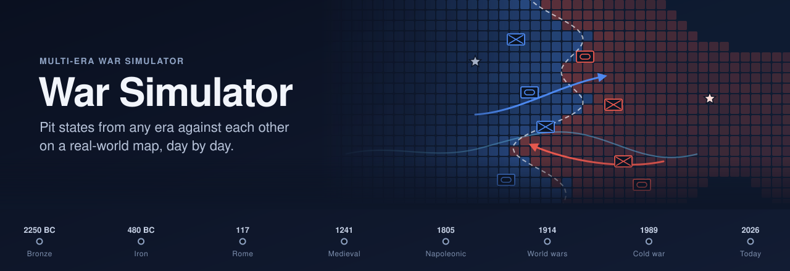
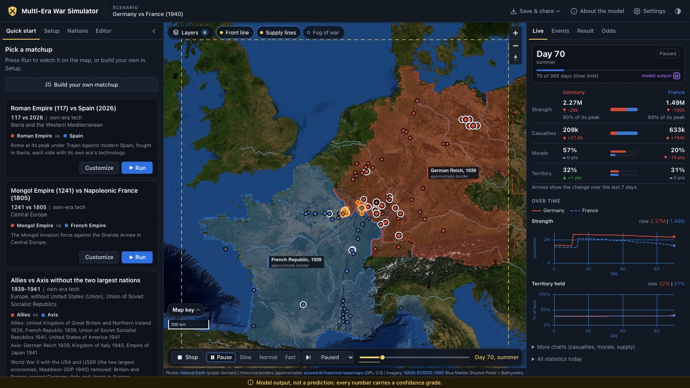

<p align="center">
  
</p>

<p align="center">
  <a href="https://github.com/IchNukeDichWeg/war-simulator/actions/workflows/ci.yml"></a>
  <a href="https://github.com/IchNukeDichWeg/war-simulator/releases"></a>
  <a href="LICENSE"></a>
  
  
  
</p>

<p align="center">
  <b>Rome in 117 against Spain in 2026. The Mongols against Napoleon. NATO against the Warsaw Pact.</b><br>
  Pick any states from any era, put them on a real-world map and watch the war play out day by day.
</p>

<p align="center">
  <a href="https://ichnukedichweg.github.io/war-simulator/"><b>Live demo</b></a> ·
  <a href="#quick-start">Quick start</a> ·
  <a href="#features">Features</a> ·
  <a href="#how-it-works">How it works</a> ·
  <a href="#development">Development</a> ·
  <a href="#data-sources-and-licences">Data sources</a>
</p>

<p align="center">
  
</p>

> [!NOTE]
> The output is a model, not a prediction. Every number in the data carries a source and a confidence
> grade (A to D), and the engine is checked against 24 historical battles in [VALIDATION.md](VALIDATION.md).

## Quick start

Try it in the browser at **[ichnukedichweg.github.io/war-simulator](https://ichnukedichweg.github.io/war-simulator/)**,
deployed from each release tag. To run it locally:

You need **Node.js 22.12 or newer** and a browser with WebGL. The simulation data ships with the
repository; the map imagery and elevation tiles load from NASA GIBS and AWS Terrain Tiles at runtime.

```sh
git clone https://github.com/IchNukeDichWeg/war-simulator.git
cd war-simulator
npm ci
npm run dev
```

Open http://localhost:5173, pick a matchup in **Quick start** and press **Run**. To build your own war,
open **Setup**, choose the nations for each side, the year of each, the theater and the victory rules.

## Features

- **Any state, any era.** 345 researched nation snapshots from 2250 BC to 2026 (population, economy,
  force mix, technology, doctrine), plus 889 lower-confidence snapshots derived for every larger
  polity in the historical borders data. 883 nations in all.
- **24 ready-made matchups**, from Persia against the Greek city-states to the United States against
  China in 2026, including coalitions such as the Central Powers against the Entente.
- **Coalitions.** Put several nations on one side. Each member brings its own army and is judged on its
  own: a coalition fights on until every real member has broken.
- **A real map.** A 0.25 degree grid built from land cover, elevation and rivers, with climate-driven
  weather, daylight, supply lines, sieges, naval lift and fog of war.
- **Own-era or equal tech.** Fight with each side's historical technology, or equalize it to ask what
  doctrine and numbers alone would do.
- **Deterministic engine.** A day-step simulation in a Web Worker: the same seed gives the same war,
  and you can seek to any day.
- **Odds.** Run a matchup many times with different seeds and see the spread of outcomes.
- **Explanations.** Every result comes with the reasons for it: losses by cause, morale, territory,
  supply, and the event log of the decisive moments.
- **Save and share.** Export a scenario to a file or a link, and edit any value of a snapshot in the
  **Editor**.
- **Your view.** Light or dark theme, a relief, muted or dark basemap, three unit sizes, the speed a
  run starts at, and map layers that stay as you left them. All of it is kept in your browser only.

## How it works

1. **Data.** Each nation is a snapshot in a given year: population, GDP, armed forces by type,
   reserves, technology level per domain and a doctrine profile. Every value has a low, mid and high
   estimate, a source and a confidence grade.
2. **Engine.** Formations move over the terrain grid, draw supply from depots, fight battles resolved
   with era-specific lethality and morale breakpoints, besiege cities and capture capitals. A war ends
   on capital capture, territory share, army or morale collapse, or the time limit.
3. **Validation.** The engine replays 24 historical battles (Cannae, Hastings, Austerlitz, France 1940,
   Iraq 2003 and others) across many seeds and is scored on winner, loss ratio and duration. The
   results, the sensitivity analysis and every verdict are in [VALIDATION.md](VALIDATION.md).

Read the in-app **Honest limits** page (**About the model** in the top bar) before drawing conclusions
from a run. The model reference is in [ENGINE.md](ENGINE.md), the design choices in
[DECISIONS.md](DECISIONS.md) and the data coverage in [COVERAGE.md](COVERAGE.md).

## Development

```sh
npm test           # vitest: 39 files, 288 tests, about 10 s
npm run typecheck  # tsc --noEmit
npm run build      # typecheck, then vite build into dist/
npm run preview    # serve dist/ on http://localhost:4173
```

The build uses relative paths (`base: './'`), so `dist/` can be served from any subdirectory, such as
GitHub Pages, where `.github/workflows/pages.yml` deploys it on every `v*` tag. `dist/` is about 31 MB, of which 29 MB is the runtime data from `public/data/`. Vite warns
about the size of the MapLibre chunk; that is expected.

<details>
<summary><b>How the app loads its data</b></summary>

The first screen (nation lists, presets, the map) waits only for `snapshots.json`,
`snapshots-phase3-index.json`, `nations.json`, `mechanics.json`, `coalitions.json` and `presets.json`.
Right after it the app fetches what only a run needs, and the borders: `doctrines.json`,
`terrain/grid.pack.gz`, `climate/zones.bin.gz`, `borders.json` and `snapshot-notes.json` (the note and
source prose the build splits off `snapshots.json`). A run started before those are in waits for them.
Phase 3 snapshots load per era on first use. `battles.json` is only read by the backtest. The `.gz`
grids are inflated with `DecompressionStream`; without it the app falls back to `terrain/grid.bin` and
`climate/zones.bin`.

Measured with `vite preview` in headless Chrome at an emulated 40 Mbit/s and 20 ms round trip, cache
off: the first screen takes 0.49-0.55 s and 0.96 MB, with every data file in by 1.3-1.4 s (4.17 MB).
</details>

<details>
<summary><b>Data pipeline</b></summary>

Research lives in `data/` (raw snapshots, doctrine, mechanics constants, battle cases). The pipeline
turns it into the runtime files in `public/data/`, which are committed, so you only need it after
changing `data/` or to re-fetch the upstream sources. Every download is cached in `.cache/`
(gitignored), keyed by URL, so a second run is offline and reproducible.

Run the steps in this order (later steps read earlier outputs):

| Order | Command | What it does | Network (first run) | Time, warm cache |
| --- | --- | --- | --- | --- |
| 1 | `npm run data:terrain` | Global 0.25 deg terrain grid from NASA GIBS MODIS land cover, AWS Terrain Tiles elevation and Natural Earth rivers. | 307 requests, 20 MB | 1.6 s |
| 2 | `npm run data:climate` | Koppen-Geiger climate zone grid (Beck et al. 2018). | One 71 MB zip from figshare, md5-checked | 0.2 s |
| 3 | `npm run data:worldbank` | World Bank indicators for every country into `data/raw/worldbank.json`. | 18 requests, 1.0 MB | 0.2 s |
| 4 | `npm run data:modern` | Regenerates the `auto-base` 2026 snapshots for states without a researched one. Never touches researched files. | 2 Natural Earth files, 1.1 MB | 0.7 s |
| 5 | `npm run data:phase3-enumerate` | Lists historical-basemaps polities that have no snapshot. | historical-basemaps world files | 0.9 s |
| 6 | `npm run data:phase3` | Derives a low-confidence `phase3` snapshot per enumerated polity. | OWID population CSV and Natural Earth, 4.7 MB | 1.4 s |
| 7 | `npm run data:validate` | Schema and cross-field checks over `data/`. Exits non-zero on any error. | No | 0.5 s |
| 8 | `npm run data:build` | Builds everything in `public/data/`. Run it after steps 1 and 2 too, or the gzipped grids go stale. | historical-basemaps and Natural Earth | 51 s |
| 9 | `npm run data:coverage` | Rewrites `COVERAGE.md`. | historical-basemaps world files (shared with steps 5 and 8) | 1.0 s |

Warm-cache times were measured on an Apple M5 Pro with Node 26.5.0. The historical-basemaps files
are pinned to upstream commit `7bed003`; a rebuild from it reproduces `public/data` byte for byte.
The Phase 3 steps (5 and 6) do not yet reproduce the committed Phase 3 reference files exactly. The
pipeline rewrites tracked files, so review `git diff` after a run.
</details>

<details>
<summary><b>Headless scripts: backtest, robustness screen, one scenario</b></summary>

**Backtest.** Runs every historical battle case through the engine and prints how often the
historical winner won, the loss ratio and the duration against history, then the criteria counts.

```sh
npx tsx scripts/backtest.ts --seeds 20
```

| Flag | Meaning |
| --- | --- |
| `--seeds N` | Seeds per case (default 20). |
| `--bp-quantile q1,q2,...` | Runs the set once per value, with every morale breakpoint at that quantile of its range. |
| `--ratio-quantile q1,q2,...` | Same, for the AI's required force ratios. |
| `--sweep <mechanics.path> v1,v2,...` | Sets one mechanics value to each listed value in turn. Nothing is written to disk. |
| `--only id1,id2` | Restricts the run to these case ids. |
| `--data DIR` | Reads another data directory instead of `public/data`. |
| `--json FILE` | Writes the per-case rows as JSON. |

The default run (24 cases x 20 seeds) takes about 3 s.

**Robustness screen.** Moves every grade-D constant to its low and its high, one at a time, and prints
the gate count with a 95% margin on each share.

```sh
npx tsx scripts/robustness.ts --out robustness-mine.jsonl --seeds 20
```

`--seeds N` (default 200), `--workers N` (default 0, every core), `--resume` to continue a file,
`--data DIR`. An existing `--out` file is refused unless `--resume` is given. Ctrl-C prints the
summary so far and keeps the results. On 18 cores (Apple M5 Pro) the full screen took 5 min 12 s at
20 seeds and 1 h 07 min at 200 seeds.

**One scenario.**

```sh
npx tsx scripts/run-scenario.ts --preset germany-vs-france-1940 --seed 7 --events
```

Runs a preset (`--preset ID`), a scenario file (`--file F`) or an ad-hoc matchup
(`--a SNAP --b SNAP --bbox w,s,e,n`) and prints the winner, the end reason, per-side statistics and the
reasons for the outcome.
</details>

### Project layout

```
src/
  engine/        simulation core, run in a Web Worker; deterministic per seed
  map/           MapLibre controller, unit layer, overlays
  ui/            React app, panels, store, engine bridge, honest-limits page
  types/         shared types: snapshot schema, mechanics, scenario
data/            research input: snapshots, doctrine, mechanics, battles, presets, SOURCES.md
data-pipeline/   fetch, generate, validate and build scripts
public/data/     built runtime data the app loads (committed)
scripts/         headless backtest, robustness screen, scenario runner, banner generator
validation/      robustness campaign results
tests/           Vitest suites and fixtures
```

## Data sources and licences

The runtime data includes material derived from third-party datasets under their own licences. Per-value
citations are in each JSON `source` field; source families, citation rules and derivation methods are in
[data/SOURCES.md](data/SOURCES.md).

| Data | Source | Licence |
| --- | --- | --- |
| Historical borders, Phase 3 snapshots | Ourednik, A., [historical-basemaps](https://github.com/aourednik/historical-basemaps) | GPL-3.0 |
| Modern population, economy, armed forces | World Bank, [World Development Indicators](https://data.worldbank.org/) (armed forces from IISS, farm employment from ILO) | CC BY 4.0 |
| Modern military expenditure | [SIPRI Military Expenditure Database](https://www.sipri.org/databases/milex), via the World Bank | SIPRI terms, see below |
| Climate zones | Beck, H.E. et al. 2018, [Present and future Koppen-Geiger climate classification maps at 1-km resolution](https://doi.org/10.1038/sdata.2018.214), Scientific Data 5:180214 | CC BY 4.0 |
| Historical population, urbanization, land area, GDP | [Our World in Data](https://ourworldindata.org/) (HYDE, Gapminder, UN WPP, FAO) and the [Maddison Project Database 2023](https://www.rug.nl/ggdc/historicaldevelopment/maddison/) (Bolt and van Zanden 2024) | CC BY 4.0 |
| Historical population and army data | [Seshat Global History Databank](https://seshat-db.com) | CC BY-SA 4.0 |
| Land cover, base imagery | [NASA EOSDIS GIBS](https://www.earthdata.nasa.gov/engage/open-data-services-software/earthdata-developer-portal/gibs-api) (MODIS MCD12Q1, Blue Marble) | Public domain |
| Elevation | [AWS Terrain Tiles](https://registry.opendata.aws/terrain-tiles/) (Mapzen / Tilezen joerd) | Open data, attribution below |
| Rivers, countries, ports | Made with [Natural Earth](https://www.naturalearthdata.com/) v5.1.2 | Public domain |

<details>
<summary><b>Required attributions</b></summary>

- This project used data from the Seshat Databank (https://seshat-db.com) under the Creative Commons
  Attribution-ShareAlike 4.0 International License (https://creativecommons.org/licenses/by-sa/4.0/).
- We acknowledge the use of imagery provided by services from NASA's Global Imagery Browse Services
  (GIBS), part of NASA's Earth Science Data and Information System (ESDIS).
- Elevation, from the [Tilezen joerd attribution list](https://github.com/tilezen/joerd/blob/master/docs/attribution.md):
  ArcticDEM terrain data DEM(s) were created from DigitalGlobe, Inc., imagery and funded under National
  Science Foundation awards 1043681, 1559691, and 1542736; Australia terrain data © Commonwealth of
  Australia (Geoscience Australia) 2017; Austria terrain data © offene Daten Österreichs, Digitales
  Geländemodell (DGM) Österreich; Canada terrain data contains information licensed under the Open
  Government Licence, Canada; Europe terrain data produced using Copernicus data and information funded
  by the European Union, EU-DEM layers; Global ETOPO1 terrain data U.S. National Oceanic and Atmospheric
  Administration; Mexico terrain data source: INEGI, Continental relief, 2016; New Zealand terrain data
  Copyright 2011 Crown copyright (c) Land Information New Zealand and the New Zealand Government (All
  rights reserved); Norway terrain data © Kartverket; United Kingdom terrain data © Environment Agency
  copyright and/or database right 2015. All rights reserved; United States 3DEP (formerly NED) and global
  GMTED2010 and SRTM terrain data courtesy of the U.S. Geological Survey.
</details>

The map shows the main attributions while it is open.

## Licence

The code and data are released under the [GNU General Public License v3.0](LICENSE). The historical
borders are derived from GPL-3.0 data, and the CC BY 4.0 and CC BY-SA 4.0 inputs listed above are
compatible with it; their attribution requirements still apply.

**Exception.** The military-expenditure values from SIPRI (World Bank series `MS.MIL.XPND.CD` and
`MS.MIL.XPND.GD.ZS`, in `data/raw/worldbank.json` and the modern snapshots) are © SIPRI and are not
covered by the GPL. They are reproduced for non-commercial research under
[SIPRI's terms](https://www.sipri.org/about/terms-and-conditions).
